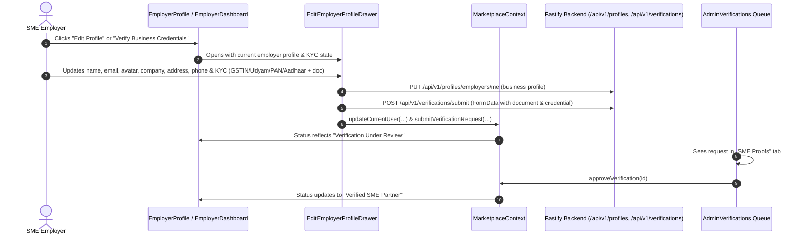
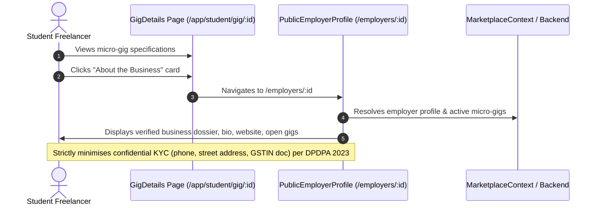
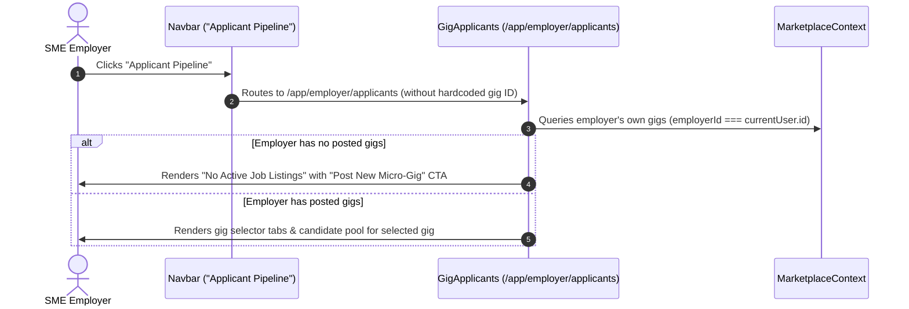
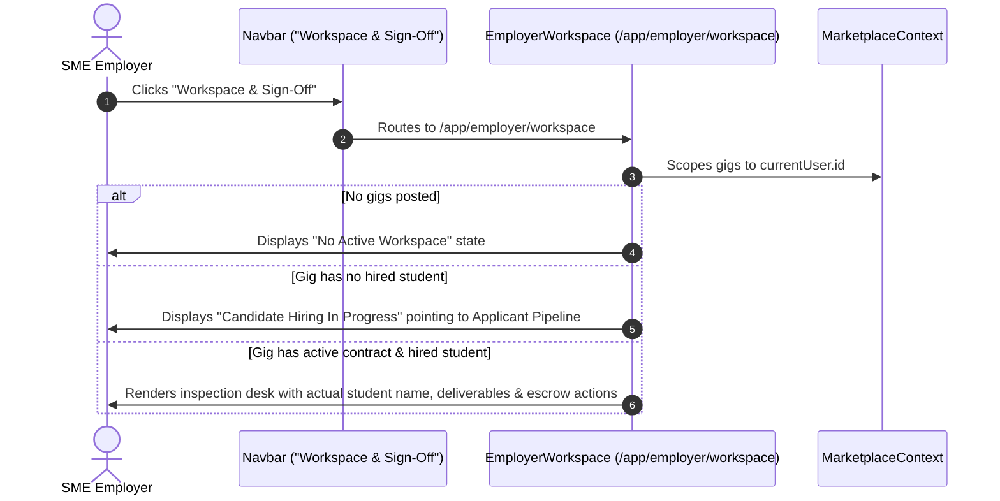

# Execution Flow Map: Employer Verification, Pipeline & Workspace Resolution

## 1. Feature Context
- **Feature Target:** Employer Profile Customization, Credential Verification (GSTIN/Udyam/PAN/Aadhaar), Public Employer Profile Dossier, Dynamic Applicant Pipeline & Sanitized Employer Workspace.
- **Affected Roles:** `employer`, `student`, `admin`.

## 2. Execution Sequences

### Flow A: Employer Profile Customization & KYC Submission

### Flow B: Public Employer Profile Inspection by Student

### Flow C: Dynamic Applicant Pipeline Navigation

### Flow D: Multi-Gig Sanitized Employer Workspace

## 3. Boundary Crossings & Safety Gates
1. **Confidentiality Gate (DPDPA 2023):** Physical business address and contact phone numbers are stored as internal KYC attributes and explicitly excluded from the public employer profile view.
2. **Gig Assignment Gate:** Workspaces no longer assume or inject static mock names (e.g. `Aarav Sharma`) when an employer has no hired candidate.
3. **Route Neutrality:** Navbar navigation paths for pipeline and workspace are decoupled from static seeded mock IDs.
