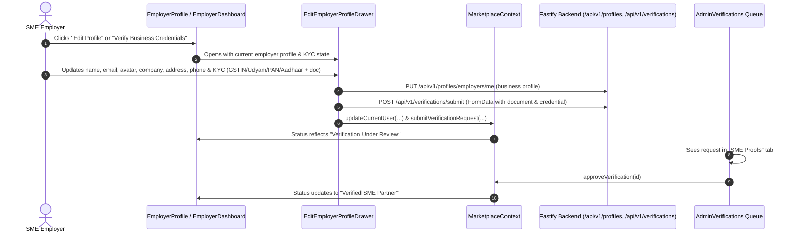
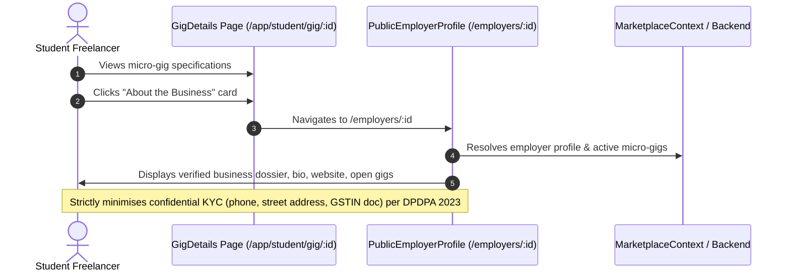
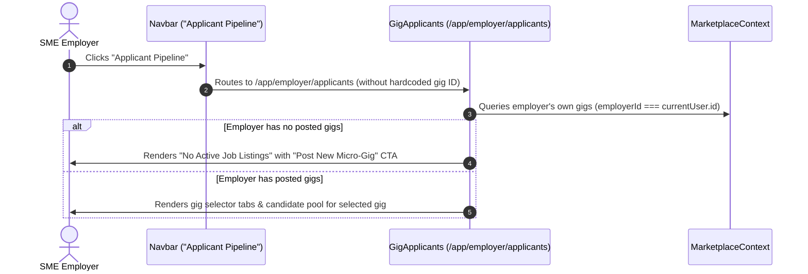
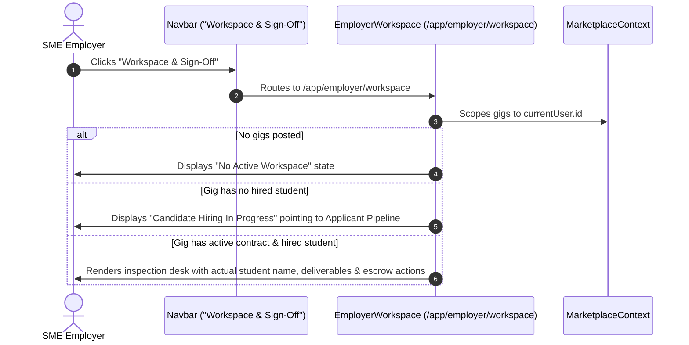
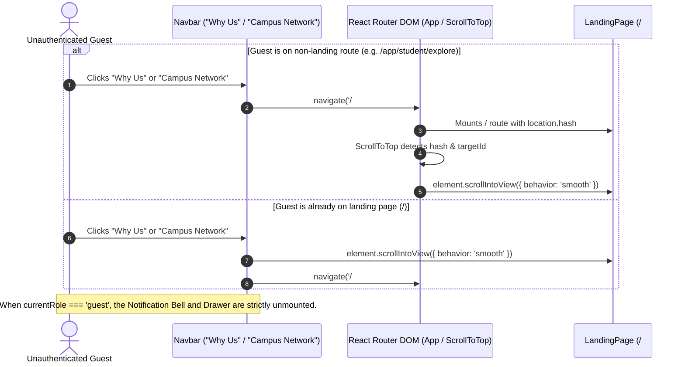
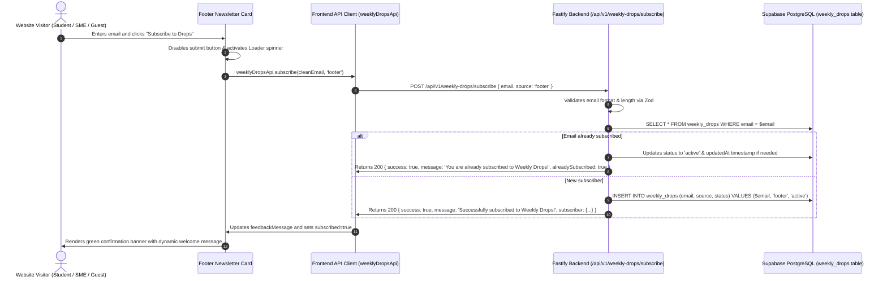
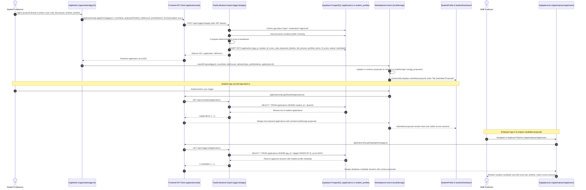
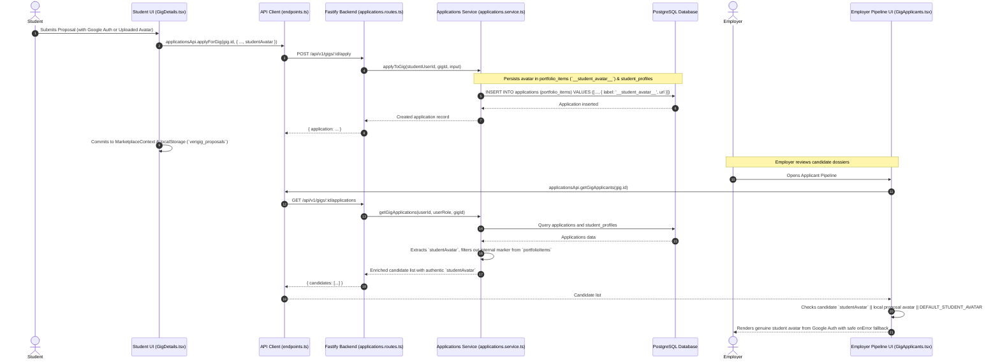
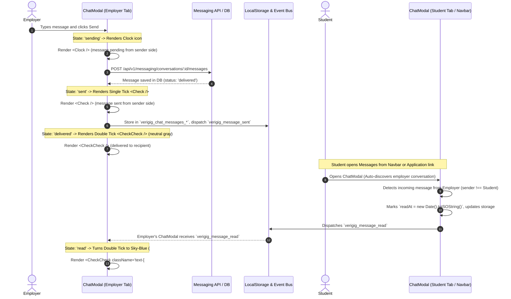

# Execution Flow Map: Employer Verification, Pipeline & Workspace Resolution

## 1. Feature Context
- **Feature Target:** Employer Profile Customization, Credential Verification (GSTIN/Udyam/PAN/Aadhaar), Public Employer Profile Dossier, Dynamic Applicant Pipeline & Sanitized Employer Workspace.
- **Affected Roles:** `employer`, `student`, `admin`.

## 2. Execution Sequences

### Flow A: Employer Profile Customization & KYC Submission

### Flow B: Public Employer Profile Inspection by Student

### Flow C: Dynamic Applicant Pipeline Navigation

### Flow D: Multi-Gig Sanitized Employer Workspace

### Flow E: Cross-Route Guest Section Navigation & Notification Concealment

### Flow F: Weekly Drops Newsletter Subscription & Database Persistence

### Flow G: Student Proposal Submission, Session Persistence & Employer Pipeline Synchronization

### Flow 8: Student Authentic Profile Avatar Propagation & Fallback

### Flow 9: Real-time Multi-Role Messaging & Delivery Ticks State Machine

## 3. Boundary Crossings & Safety Gates
1. **Confidentiality Gate (DPDPA 2023):** Physical business address and contact phone numbers are stored as internal KYC attributes and explicitly excluded from the public employer profile view.
2. **Gig Assignment Gate:** Workspaces no longer assume or inject static mock names (e.g. `Aarav Sharma`) when an employer has no hired candidate.
3. **Route Neutrality:** Navbar navigation paths for pipeline and workspace are decoupled from static seeded mock IDs.
4. **Guest Authentication & Navigation Isolation:** Inactive notification bells and empty drawer containers are prohibited for guests (`currentRole !== 'guest'`), and section anchor links gracefully transition cross-route to the landing page with sticky-header clearance (`scroll-mt-24`).
5. **Newsletter Deduplication & Sanitization Gate:** All newsletter submissions are normalized (trimmed, lowercased), schema-validated with strict regex email constraints, deduplicated against the unique constraint on `weekly_drops.email`, and protected by optimistic fallback handling during presentation modes.
6. **Proposal Persistence & Schema Safety Gate:** Proposal submissions strictly provide required `termsAccepted: true` and `bidAmount`, auto-prefix URLs, auto-provision student profiles if uninitialized, and commit proposals to both PostgreSQL and `localStorage` so proposals persist across session logouts and remain immediately visible in both student dashboards and employer pipeline dossiers.
7. **Student Avatar Propagation & Fallback Gate:** Student Google OAuth avatar URLs are transmitted during proposal submission, persisted in application portfolio records (`__student_avatar__`) and student profile links, and displayed in employer applicant pipeline lists and dossier modals. If a user registered with email and has no avatar, it safely defaults to `DEFAULT_STUDENT_AVATAR` with an `onError` client fallback.
8. **Messaging Delivery State Machine & Context Discovery Gate:** Replaces hardcoded clock icons with a deterministic 4-stage delivery state machine: `sending` (Clock icon) -> `sent` (Single check) -> `delivered` (Double check in neutral gray) -> `read` (Double check in WhatsApp sky-blue `#38BDF8`). Relaxes backend schemas from rigid UUID validation to deterministic UUID hashing (`toValidUuid`), enables multi-thread switching in `ChatModal`, and dynamic active conversation auto-discovery in `Navbar.tsx`.

